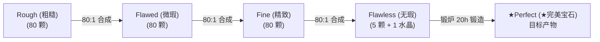

# Hypixel SkyBlock 宝石倒卖 (Gemstone Flipping) 全流程实战与商业指南

> **核心目标**：通过在 Bazaar 挂单采购低级别宝石（以 **Flawed 微瑕** 为首选原料），批量合成至 Flawless 等级，每 5 颗 Flawless 配合 1 颗对应水晶进入锻炉（The Forge）锻造 **★Perfect (★完美) 宝石**，最终在 Bazaar 挂单售出赚取高额利润与时薪。本项目不考虑售出次级别宝石。

---

## 一、 宝石品质等级体系与数学换算链条

### 1.1 严格单向 80:1 升级法则
在 Hypixel SkyBlock 中，宝石只能**自下而上单向合成**，**绝对不允许逆向分解**。各层级之间为恒定 **80 倍压缩率**：

### 1.2 原料数量与 Bazaar 订单上限 (71,680) 约束表
| 原料品质 | 制作 1 颗 Flawless 所需 | 制作 1 颗 ★Perfect 所需 (5 Flawless) | 对应 Bazaar 单次挂单上限 (71,680) 笔数 | 实操可行性与操作建议 |
| :--- | :---: | :---: | :---: | :--- |
| **Flawed (微瑕)** *(推荐)* | 6,400 颗 | **32,000 颗** | **约 0.45 单** (不到半单即可做1炉) | **推荐品质**！两单 64,000 颗即可供 2 炉运作，成交极快，常年存在明显折价 |
| **Fine (精致)** *(快速)* | 80 颗 | **400 颗** | **约 0.005 单** | **快速省心**。挂单 400-2,800 颗秒成交，仅需背包点 5 次合成即可入炉，适合资金充裕玩家 |
| **Flawless (无瑕)** *(免合成)* | 1 颗 | **5 颗** | **5 颗** (无需批量) | **免合成直接进炉**。但因市场定价充分，仅能赚取锻炉等待差价，利润空间最薄 |
| **Rough (粗糙)** *(不推荐)* | 512,000 颗 | **2,560,000 颗** | **约 35.7 单** (7 炉需 250 单) | **⚠️ 繁琐不推荐**！虽单价看似最低，但巨量订单会导致频繁卡单、被竞价、背包反复堵塞，严重浪费机会成本 |

---

## 二、 采购与售出环节的商业化原则

### 2.1 原料采购环节
- **优先订单预购 (Buy Order - 最低成本)**：主打操作方式，以最高的买单竞价挂单（通常比即时卖出价高 0.1 Coin），享有 20%-50% 的采购折扣；
- **允许立即购买 (Instant Buy - 快速到货)**：当特定宝石行情急剧拉升、或者玩家不愿等待挂单耗时、想要立即填满 7 个锻炉槽位时，可直接秒买现货。系统提供了“即时买入净利润”供懒人估算。

### 2.2 产物售出环节
- **优先订单出售 (Sell Offer - 追求最高收益)**：常规情况下**必须挂单出售**（挂在当前最低卖单少 0.1 Coin 处），扣除 1% 交易行税率后获得最大化纯利润；
- **应急秒卖变现 (Instant Sell - 仅用于价格踩踏避险)**：日常严禁直接秒卖，因为会有巨大点差亏损。**唯一的例外**是当市场因节日倾销或大户砸盘引发严重踩踏时，若测算秒卖仍有利可图且价格正在崩跌，可使用“秒卖变现”功能快速清仓止损。

---

## 三、 水晶 (Crystal) 获取难度与配方繁杂度分级矩阵

锻造每颗 ★Perfect 宝石均强制要求消耗 1 颗对应的灵魂绑定水晶。根据社区维基（[https://hypixelskyblock.minecraft.wiki](https://hypixelskyblock.minecraft.wiki)）与实战测试，分级与成本如下：

| 等级 | 涵盖宝石 | 获取地点与详细机制 | 额外金币成本 | 优先等级与倒卖建议 |
| :---: | :--- | :--- | :---: | :--- |
| **S级** (速刷/5) | **Amber (琥珀) Topaz (黄玉)** | **Amber**: 哥布林女皇巢穴 (Goblin Queen's Den)，手持 King's Scent 直接采摘水晶。 **Topaz**: 熔岩弹幕神庙 (Khazad-dûm)，击杀怪或放道具直接刷取。 | **0 Coins** | **S级 (速刷 • 最高优先)** 零金币投入，可无限反复快速刷新，批量倒卖首选。 |
| **A级** (蓝宝石/3) | **Sapphire (蓝宝石)** | 先行者城市 (Precursor City)，需将 6 个机器零件（Electron Transmitter 等）交予机器人教授换取。 | **约 1M Coins** (需买 Precursor Apparatus) | **A级 (蓝宝石 • 高优先)** 水晶可反复刷，但单颗需固定扣除约 0.8M-1.2M 道具成本。 |
| **B级** (慢刷/2) | **Amethyst (紫水晶) Jade (翡翠)** | **Amethyst**: 丛林神庙 (Jungle Temple)，需用 Jungle Key 开门后通过绊线钩跑酷取得。 **Jade**: 迪万矿山 (Mines of Divan)，矿洞开箱寻找 4 件矿工工具提交。 | **Amethyst: 约 240k** (Jungle Key) **Jade: 0 Coins** | **B级 (慢刷 • 中等优先)** 可循环刷取，但有跑酷解密与探图流程消耗。 |
| **C级** (限跑/1) | **Jasper (碧玉) Ruby (红宝石)** | 水晶核探险 (Nucleus Run) 提交 5 颗水晶最终偶得，或在冰川隧道矿井 (Glacite Mineshaft) 偶得。 | **0 Coins** (库存消耗) | **C级 (限跑水晶/冰洞偶得)** 无法高频稳定量产，适合手头有探险库存时制作。 |
| **GTMS only** (0) | **Onyx (黑玛瑙) Citrine (黄水晶) Peridot (橄榄石) Aquamarine (海蓝宝)** | 仅在冰川隧道矿井 (Glacite Mineshaft) 的冰冻尸体与宝箱中偶得。 | **0 Coins** (库存消耗) | **GTMS only (仅限冰洞偶得)** 虽然单颗利润经常高达 10M+，但因受限于水晶偶得几率，无法全天候工业化走量。 |
| **OPAL** (-1) | **Opal (蛋白石)** | 同样出自冰川矿井，但不是 Great Forger 成就或博物馆任务刚需，属性为 True Defense，需求偏低。 | **0 Coins** | **OPAL (蛋白石)** 流动性较差，非必要不建议大量囤积。 |

---

## 四、 玩家实战收货核心心法 (Field Operations)

这是倒卖老玩家经过数千次订单总结的独门收货技巧：

### 4.1 Flawed 订单 100% Filled 后的“Flip-Cancel 挤爆仓”技巧
1. 在 Bazaar 挂单采购 **71,680 颗 Flawed 宝石**（Bazaar 单笔允许的最大数量）；
2. 当订单完全成交（100% Filled）后，**不要点击逐个背包收货**；
3. 点击订单右侧的 **“Flip” 功能**将其转为出售挂单，然后**立刻点击“Cancel”取消该出售挂单**！
4. **底层原理**：系统在取消出售单时，会一次性将订单中的 71,680 颗宝石强制退回给玩家。当背包 36 格全部塞满后，剩余的数万颗宝石会**自动全部挤入玩家的 Stash（临时暂存区）**！
5. 玩家随后只需点击快速存入 **Gemstone Sack（宝石袋）**；
6. 接着打开工作台，使用 **Supercraft (超能合成)** 配合 Sack 内的数万宝石，一瞬间即可全部合成出所需的 Fine 与 Flawless！极度丝滑省时。
> **⚠️ 核心前提**：Flip-Cancel 技巧**仅限于订单 100% 满额**时生效。

### 4.2 未满单（Partial Fill）与 Personal Compactor 7000 协同
- 若市场供货较慢，订单只成交了 20,000-40,000 颗，此时无法使用 Flip-Cancel；
- 玩家只能点击“填满背包 (Claim all to inventory)”；
- **必备装备**：在饰品栏或背包中佩戴好 **Personal Compactor 7000**，并将其槽位设定为对应的 `FLAWED_XXX_GEM -> FINE_XXX_GEM`；
- 每次从订单提取宝石进背包时，Compactor 会**实时自动将其压缩为 Fine 宝石**，背包格子永远不会被占满，玩家只需狂点收货即可瞬间清空订单。

### 4.3 竞价被压单 (Outbid) 的资金管理
- Bazaar 经常有人以“高 0.1 Coin”压制你的预购单；
- **正确做法**：始终在钱包或银行保留 1-2 份冗余流动资金。当旧单被压时，不要慌忙撤单，而是**立刻开一个新单加价 0.1 压回去**；
- 随后点开旧单，收走已经成交的部分原料，再 Cancel 取消旧单取回未成交的货款本金，保持货源持续流入。

### 4.4 挖矿节 (Mining Fiesta) 的供求周期波动律
- **狂欢期暴跌（黄金抄底窗口）**：当市长 Cole 开启挖矿节（特别是全服长期未有挖矿节之后），全服海量玩家涌入矿区疯狂采掘，初级宝石瞬间供过于求，大量玩家在 Bazaar 砸盘抛售，**导致 Flawed / Rough 价格深度跳水**。此时是果断下重金满额预购抄底的最佳时机！
- **出炉期价格下挫（规避踩踏）**：当抄底玩家大批将初级宝石送入锻炉后，**10-20 小时后全服 Perfect 宝石将集中出炉**，市场可能迎来一波 Perfect 的压价抛售。因此，在挖矿节期间挂单出售 Perfect 时，要适当预留利润回撤空间，或在出炉前提前锁定卖单。

---

## 五、 NPC 收购保底价（严格核查）

> **⚠️ 关键规则**：在 Hypixel Skyblock 中，**Flawless 和 Perfect 宝石无法出售给任何 NPC**（防止玩家误售珍品）。只有 Rough、Flawed、Fine 允许出售给 NPC。NPC 价格不计入锻造 Perfect 的成本，仅作为市场下限与无风险套利指标。

| 宝石层级 | 标准宝石 (Ruby, Amber, Topaz, Sapphire, Amethyst, Jade, Opal) | 特殊/冰川宝石 (Jasper, Onyx, Citrine, Peridot, Aquamarine) | 能否卖给 NPC |
| :--- | :---: | :---: | :---: |
| **Rough (粗糙)** | **3** Coins | **4** Coins | ✔️ 可以 |
| **Flawed (微瑕)** | **240** Coins (3×80) | **320** Coins (4×80) | ✔️ 可以 |
| **Fine (精致)** | **19,200** Coins (240×80) | **25,600** Coins (320×80) | ✔️ 可以 |
| **Flawless (无瑕)** | *不可出售 (None)* | *不可出售 (None)* | ❌ 严禁出售给 NPC |
| **★Perfect (★完美)** | *不可出售 (None)* | *不可出售 (None)* | ❌ 严禁出售给 NPC |

---

## 六、 锻造时长公式与 HotM 技能树

社区维基依据：[https://hypixelskyblock.minecraft.wiki/w/The_Forge](https://hypixelskyblock.minecraft.wiki/w/The_Forge)

$$\text{锻造时长} = 20\text{h} \times (1 - \text{QuickForge\%}) \times (1 - \text{Cole\%})$$

- **基准时长**：20 小时；
- **HotM 门槛**：必须达到 **Heart of the Mountain 5**；
- **Quick Forge 特技**：HotM Tier 3 右侧特技，最高 20 级，每级减免 1.5%，满级减免 **30.0%**；
- **Cole 市长 Molten Forge 特技**：当选市长或部长且特技生效时，提供 **25.0%** 独立减免；
- **满配极限时间**：$$20 \times (1 - 0.30) \times (1 - 0.25) = \mathbf{10.5 \text{ 小时 (10h 30m)}}$$
  1 天可稳定周转 2.2 轮，7 槽位全开日产量高达 **15 颗 ★Perfect 宝石**！
